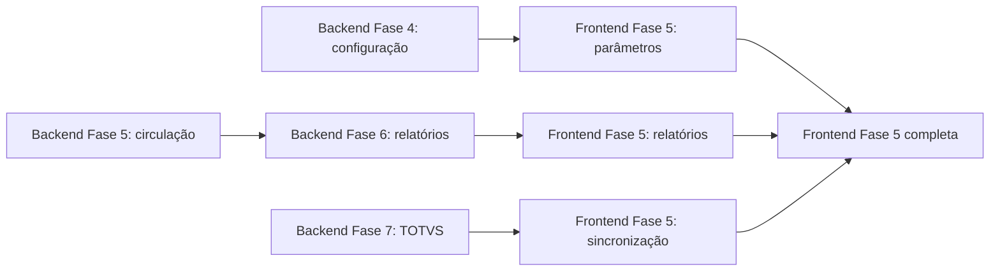

# Plano de implementação — Backend Fase 6 e Frontend Fase 5

## Estado atual

- **Backend Fase 6 — Reports:** concluída. Endpoint, agregações para acervo, empréstimos e reservas e testes adicionados em `backend/tests/test_relatorios.py`.
- **Frontend Fase 5 — Web Reports & Settings:** relatórios e configurações concluídos. Sincronização TOTVS adiada por decisão do usuário; a fase permanece parcialmente concluída.
- **Dependência adiada:** sincronização web depende do Backend Fase 7 (TOTVS Sync), que permanece pendente. A configuração usa o Backend Fase 4 já implementado.

Não implementar cálculos dos relatórios no navegador. O backend deve devolver indicadores e resultados prontos, conforme o tech-spec e o guia visual.

`python3 -m compileall`, `npm run typecheck` e `next build --webpack` passaram. A suíte backend não pôde ser executada: este ambiente não tem o comando Docker nem Django instalado. O repositório também não define o protocolo, as credenciais de ambiente ou uma rota TOTVS; não foi criado um endpoint fictício.

## Dependências

## Trilha A — Backend Fase 6: relatórios

### A1. Fechar o catálogo e as regras antes dos endpoints

O tech-spec só define que o backend calcula relatórios; `docs/design-branding.md` define tabelas/gráficos legíveis e indicadores de empréstimo em atraso ou prazo próximo quando fornecidos pelo backend. Antes de codificar, registrar:

- Quais consultas a equipe precisa fazer e que decisão cada uma apoia.
- Métrica, unidade, agrupamento, filtros, ordenação e formato de cada resultado.
- Definição temporal: intervalo inclusivo/exclusivo, data local em `America/Manaus` e comportamento para período vazio.
- Tratamento de registros inativos, devolvidos, reservas encerradas e exemplares inativos.
- Quais indicadores são contagens e quais listas/tabelas precisam de paginação.

Como ponto de partida para validar com a biblioteca, avaliar: estado do acervo (exemplares disponíveis/emprestados); circulação por período (retiradas/devoluções); empréstimos ativos, vencidos e próximos do vencimento; reservas agrupadas por situação. Não transformar essa lista em contrato até confirmar os critérios e filtros necessários.

**Pronto quando:** catálogo e definições podem ser mapeados para modelos/campos existentes sem regra ambígua ou cálculo duplicado na web.

### A2. Definir contrato e autorização

- Criar rotas de leitura para os relatórios escolhidos, com filtros e formatos de resposta documentados no `docs/tech-spec.md`.
- Restringir acesso à equipe da biblioteca (bibliotecário e administrador); dados agregados não podem expor informações de alunos sem necessidade operacional.
- Validar filtros no serializer e devolver erros no envelope padrão da API.
- Decidir paginação/limites para tabelas grandes sem alterar contratos existentes de reservas e empréstimos.

**Pronto quando:** cada tela frontend tem um contrato tipado, com autorização e formato estáveis.

### A3. Implementar consultas e cálculos

- Manter views/serializers finos e colocar consultas, agregações e cálculos no service da área de relatórios.
- Usar agregações do ORM no banco; selecionar relações necessárias e evitar carregar histórico completo ou gerar N+1.
- Calcular atraso e prazo próximo no backend com data local de Manaus e regras explicitadas em A1. Não criar estado persistente novo para atraso.
- Garantir que filtros de período e situação não alterem registros; os endpoints são somente leitura.

**Pronto quando:** resultados são reproduzíveis, eficientes em volume e coerentes com empréstimos, reservas e exemplares cadastrados.

### A4. Cobrir e documentar

- Testar permissão por perfil, filtros válidos/inválidos, limites de período, datas de borda de fuso, itens sem ocorrências e agrupamentos.
- Testar consistência dos totais com registros de empréstimo, devolução, reserva e disponibilidade, incluindo inativos conforme definição aprovada.
- Verificar volume de consultas para evitar N+1 e conferir que consultas não modificam dados.
- Documentar rotas, parâmetros, respostas, erros e exemplos no tech-spec.

## Trilha B — Frontend Fase 5: relatórios e parâmetros

### B1. Revisar e fechar a configuração existente

- Conferir a tela existente de configurações, cliente e proxy para `GET/POST/PATCH /api/v1/configuracao-biblioteca`.
- Validar criação inicial quando não há configuração, edição dos quatro campos positivos, erros por campo, renovação de sessão e acesso exclusivo de administrador.
- Preservar valores retornados pelo backend e não permitir edição de campos de auditoria ou estado ativo.

**Pronto quando:** configuração pode ser criada e editada pela interface e habilita as operações que dependem dela.

### B2. Construir relatórios

- Adicionar navegação e páginas para o catálogo de relatórios definido em A1.
- Criar tipos e clientes para os contratos A2 e encaminhamento server-side autenticado com allowlist, proteção de origem e renovação de sessão.
- Exibir números e séries fornecidos pelo backend; usar tabelas ou gráficos conforme a forma e volume dos dados.
- Oferecer filtros definidos no contrato, aplicar busca explícita, indicar filtros ativos e permitir limpar.
- Implementar carregamento, vazio, sem resultados, erro, retry e atualização; evitar mostrar números antigos como se fossem do filtro atual.
- Exibir datas e indicadores em `America/Manaus`; não inferir atraso apenas a partir de cor ou recalcular prazo no cliente.

**Pronto quando:** cada visualização corresponde a um endpoint, seus filtros refletem a resposta da API e não há regra de negócio calculada no frontend.

### B3. Acionar sincronização TOTVS

Esta parte depende do Backend Fase 7.

- Depois de o backend definir rota, permissão, resultado, falhas e comportamento contra duplicidade, adicionar ao proxy uma ação fixa para o endpoint de sincronização.
- Mostrar andamento e desabilitar reenvio enquanto a operação está em execução.
- Apresentar o resumo retornado pelo backend (criados, atualizados, ignorados e erros, se forem campos do contrato); não inventar contagens na web.
- Tratar timeout e resposta perdida como resultado incerto e orientar a consulta do estado antes de iniciar nova sincronização.
- Exibir configuração/credenciais TOTVS somente no servidor; nunca retornar segredos ao navegador.
- Preservar cadastro e operação local quando TOTVS estiver indisponível.

**Pronto quando:** somente administradores podem acionar; a interface mostra o resultado real do serviço e falhas não causam reenvio cego nem expõem credenciais.

### B4. Validar a interface

- Verificar navegação e visibilidade dos itens conforme perfil.
- Percorrer configuração inicial, edição, erro de validação, relatórios com/sem dados e sincronização com sucesso/falha, quando B3 estiver desbloqueado.
- Conferir teclado, foco, labels, contraste, estados de progresso e largura/rolagem de tabelas a partir de 1024 px, conforme `docs/design-branding.md`.

## Sequência recomendada

1. Confirmar o catálogo de relatórios e registrar fórmulas, filtros e limites.
2. Implementar e testar as APIs de relatórios no Backend Fase 6.
3. Revisar a tela e o proxy de configuração existentes; corrigir lacunas encontradas.
4. Construir navegação, clientes, proxy e páginas de relatórios com base nos contratos aprovados.
5. Implementar/fechar Backend Fase 7 e então ligar o botão de sincronização TOTVS no frontend.
6. Validar perfis, fluxos, erros e acessibilidade; a suíte backend continua pendente de ambiente com Django/Docker.
7. Registrar no `docs/tech-spec.md` a conclusão do backend 6 e dos itens de relatórios/configurações do frontend 5; manter TOTVS pendente.

## Bloqueios e fora de escopo

- Sem definição de catálogo e fórmulas, não é possível estabilizar o contrato dos relatórios.
- Sincronização TOTVS adiada: não está implementada e depende da definição e entrega do Backend Fase 7.
- Não criar cálculos de relatório no navegador, integrar diretamente o browser com TOTVS nem alterar operações existentes de reserva/circulação para compor relatórios.
- A aceitação geral web/mobile pertence à Frontend Fase 6 e não é parte desta entrega.
