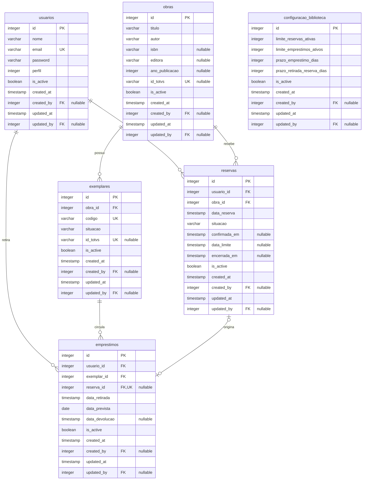
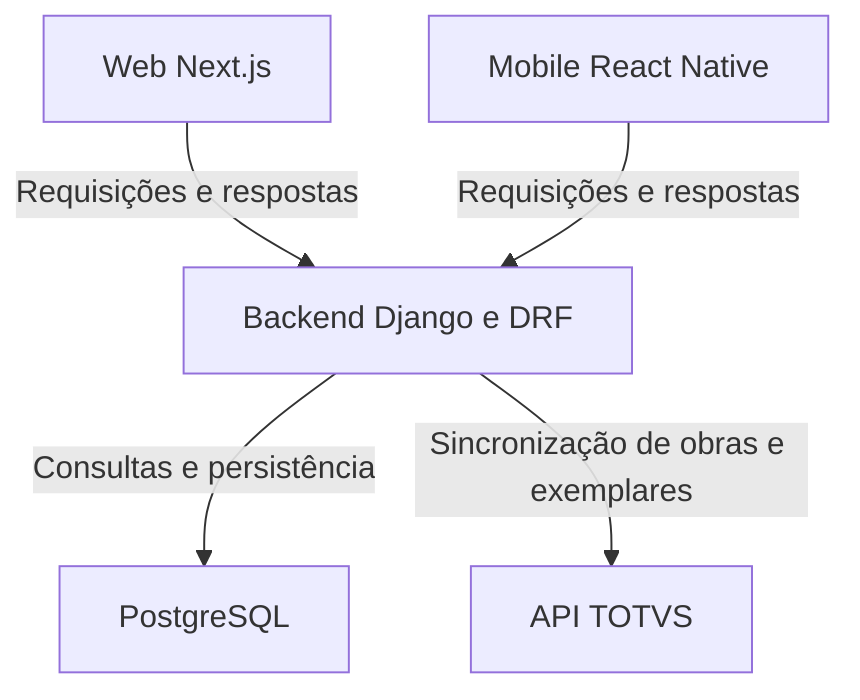

# Tech Spec

**Sistema da Biblioteca FAMETRO**

## Data Model (Diagram)



**Notes**

- Os IDs são gerados pelo Django com `AutoField`. As chaves primárias e estrangeiras são representadas como `integer`. Definir `DEFAULT_AUTO_FIELD = "django.db.models.AutoField"` e alinhar o `default_auto_field` dos AppConfig que tiverem configuração própria.
- Todas as models de domínio herdam de `BaseModel`, localizada em `backend/core/base_model.py`. Ela é uma classe base abstrata, com `Meta.abstract = True`, que compartilha campos sem gerar tabela própria.
- Os campos herdados por todas as models são exatamente `is_active`, `created_at`, `created_by`, `updated_at` e `updated_by`.
- `created_at` e `updated_at` são preenchidos pelo backend. `created_by` e `updated_by` são referências ao usuário responsável pela operação, também preenchidas pelo backend. Os relacionamentos de auditoria apontam para `usuarios` e podem ser nulos no cadastro inicial do administrador ou em operações técnicas sem usuário autenticado.
- A criação mantém `created_by` e `created_at`. As alterações atualizam `updated_by` e `updated_at`. Os clientes recebem esses campos como somente leitura.
- `is_active` controla a desativação lógica. O backend preserva o histórico e impede desativar um empréstimo ativo para contornar a devolução.
- O usuário customizado herda os campos comuns e utiliza a autenticação do Django. `password` armazena o hash gerenciado pelo Django. `is_active` é um único campo compartilhado com essa autenticação.
- Somente `obras` e `exemplares` recebem dados do TOTVS e possuem `id_totvs`. O campo é opcional, nulo quando não existe vínculo e único quando preenchido.
- Usuários, reservas, empréstimos e configuração são mantidos pelo próprio sistema. A sincronização consulta a API TOTVS para cadastrar ou atualizar exclusivamente obras e exemplares.
- `obras` representa o cadastro bibliográfico. `exemplares` representa cada unidade física, com código único e situação própria.
- A reserva pertence à obra e pode ser solicitada mesmo sem exemplar disponível. O exemplar é identificado na retirada.
- Uma reserva ativa por aluno e obra e um empréstimo ativo por exemplar devem ser protegidos por restrições de unicidade e transações no backend.
- `reserva_id` no empréstimo é opcional e vincula a retirada ao pedido atendido. O backend valida a correspondência de aluno e obra.
- Os prazos e limites ficam em uma configuração ativa da biblioteca e são aplicados pelo backend. Seus valores devem ser definidos com a biblioteca.
- As datas utilizam o suporte de fuso horário do Django, com apresentação em `America/Manaus`. Os nomes distintos de auditoria para cada model são definidos na classe abstrata para evitar colisões de relacionamentos.

**Access profiles**

O campo `perfil` armazena os códigos inteiros `1` (aluno), `2` (bibliotecário) e `3` (administrador).

- `ALUNO` utiliza o aplicativo mobile para consultar o catálogo, solicitar reserva e acompanhar suas próprias reservas.
- `BIBLIOTECARIO` utiliza o web para gerenciar obras, exemplares, reservas, retiradas, devoluções e relatórios.
- `ADMINISTRADOR` utiliza o web para administrar usuários, parâmetros, sincronização TOTVS e as operações de gestão.

**Valores de `situacao`**

- Em `exemplares`, `DISPONIVEL` ou `EMPRESTADO`. A desativação utiliza `is_active`.
- Em `reservas`, os valores propostos são `SOLICITADA`, `CONFIRMADA`, `ATENDIDA` e `CANCELADA`. As transições são validadas e executadas pelo backend.

## Architecture

Monólito Django/DRF com um app separado para cada model de domínio. O backend é responsável por toda a lógica de negócio, validação de dados, autorização, consultas, filtros, cálculos e processamento.

O web Next.js e o mobile React Native coletam os dados informados pelo usuário, enviam requisições e apresentam os dados, as ações permitidas e as mensagens retornadas pela API. Toda validação e regra de negócio é executada no backend.

Cada app contém sua model em `models.py` e os arquivos correspondentes `serializers.py`, `views.py` e `services.py`. Os arquivos `apps.py`, `urls.py` e a pasta `migrations/` completam a estrutura do app. A organização das responsabilidades segue o padrão abaixo.

- **Models** contêm os campos, relacionamentos e restrições de integridade do ORM.
- **Serializers** definem os dados de entrada e saída e validam sua estrutura no backend.
- **Views/APIs** recebem as requisições, verificam a autenticação, acionam os serviços e retornam as respostas.
- **Services** aplicam regras e permissões de negócio, executam consultas e cálculos, controlam transações, processam os dados e realizam a sincronização TOTVS.

`BaseModel` é compartilhada por todas as models de domínio. A implementação usa a classe abstrata do Django para que os campos sejam herdados pelas tabelas concretas.

```text
biblioteca-fametro/
├── backend/                                           # Django e DRF
│   ├── core/                                          # Código compartilhado
│   │   └── base_model.py                              # BaseModel abstrata com os cinco campos comuns
│   ├── config/                                        # Settings e URLs do projeto
│   ├── apps/                                          # Um app para cada model
│   │   ├── usuarios/                                  # Usuario, autenticação e permissões
│   │   │   ├── apps.py                                # Configuração do app
│   │   │   ├── models.py                              # Model do domínio com herança de BaseModel
│   │   │   ├── serializers.py                         # Entrada e saída da API
│   │   │   ├── views.py                               # Requisições e respostas HTTP
│   │   │   ├── services.py                            # Lógica, validações e processamento
│   │   │   ├── urls.py                                # Rotas da API
│   │   │   └── migrations/                            # Migrações do app
│   │   ├── obras/                                     # Obra e dados TOTVS opcionais
│   │   │   ├── apps.py                                # Configuração do app
│   │   │   ├── models.py                              # Model do domínio com herança de BaseModel
│   │   │   ├── serializers.py                         # Entrada e saída da API
│   │   │   ├── views.py                               # Requisições e respostas HTTP
│   │   │   ├── services.py                            # Lógica, validações e processamento
│   │   │   ├── urls.py                                # Rotas da API
│   │   │   └── migrations/                            # Migrações do app
│   │   ├── exemplares/                                # Exemplar e dados TOTVS opcionais
│   │   │   ├── apps.py                                # Configuração do app
│   │   │   ├── models.py                              # Model do domínio com herança de BaseModel
│   │   │   ├── serializers.py                         # Entrada e saída da API
│   │   │   ├── views.py                               # Requisições e respostas HTTP
│   │   │   ├── services.py                            # Lógica, validações e processamento
│   │   │   ├── urls.py                                # Rotas da API
│   │   │   └── migrations/                            # Migrações do app
│   │   ├── reservas/                                  # Reserva
│   │   │   ├── apps.py                                # Configuração do app
│   │   │   ├── models.py                              # Model do domínio com herança de BaseModel
│   │   │   ├── serializers.py                         # Entrada e saída da API
│   │   │   ├── views.py                               # Requisições e respostas HTTP
│   │   │   ├── services.py                            # Lógica, validações e processamento
│   │   │   ├── urls.py                                # Rotas da API
│   │   │   └── migrations/                            # Migrações do app
│   │   ├── emprestimos/                               # Emprestimo
│   │   │   ├── apps.py                                # Configuração do app
│   │   │   ├── models.py                              # Model do domínio com herança de BaseModel
│   │   │   ├── serializers.py                         # Entrada e saída da API
│   │   │   ├── views.py                               # Requisições e respostas HTTP
│   │   │   ├── services.py                            # Lógica, validações e processamento
│   │   │   ├── urls.py                                # Rotas da API
│   │   │   └── migrations/                            # Migrações do app
│   │   └── configuracao_biblioteca/                   # ConfiguracaoBiblioteca
│   │       ├── apps.py                                # Configuração do app
│   │       ├── models.py                              # Model do domínio com herança de BaseModel
│   │       ├── serializers.py                         # Entrada e saída da API
│   │       ├── views.py                               # Requisições e respostas HTTP
│   │       ├── services.py                            # Lógica, validações e processamento
│   │       ├── urls.py                                # Rotas da API
│   │       └── migrations/                            # Migrações do app
│   ├── integracoes/                                   # Comunicação externa
│   │   └── totvs.py                                   # Cliente da API para obras e exemplares
│   └── manage.py
├── frontend/                                          # Next.js para bibliotecário e administrador
│   └── src/
│       ├── app/                                       # App Router
│       │   ├── (auth)/login/                          # Login da gestão
│       │   └── (app)/
│       │       ├── obras/                             # Cadastro de livros
│       │       ├── exemplares/                        # Cadastro e disponibilidade
│       │       ├── usuarios/                          # Administração de usuários
│       │       ├── reservas/                          # Gerenciamento de reservas
│       │       ├── circulacao/                        # Retiradas e devoluções
│       │       ├── relatorios/                        # Resultados calculados pelo backend
│       │       └── configuracoes/                     # Parâmetros e sincronização TOTVS
│       ├── components/                                # Componentes de apresentação
│       ├── lib/api/                                   # Clientes HTTP tipados
│       └── types/                                     # Tipos das respostas da API
├── infra/                                             # Dockerfiles, Docker Compose e configurações de ambiente
├── docs/                                              # SDD
│   ├── TechSpec_Biblioteca_FAMETRO.md
│   ├── especificacoes/                                # Regras, contratos e critérios de aceitação
│   ├── tarefas/                                       # Tarefas derivadas das especificações
│   └── decisoes/                                      # Decisões técnicas
├── mobile/                                            # React Native para o aluno, após backend e web
│   ├── App.tsx                                        # Inicialização dos providers e da navegação
│   └── src/
│       ├── navigation/
│       │   ├── RootNavigator.tsx                      # Login e navegação autenticada
│       │   └── AppTabs.tsx                            # Abas Catálogo e Minhas reservas
│       ├── contexts/
│       │   └── AuthContext.tsx                        # Sessão e identidade retornadas pela API
│       ├── screens/
│       │   ├── LoginScreen.tsx
│       │   ├── CatalogoScreen.tsx
│       │   ├── DetalheObraScreen.tsx
│       │   └── MinhasReservasScreen.tsx
│       ├── components/                                # Componentes de apresentação e estados visuais
│       ├── services/
│       │   ├── api.ts                                 # Fetch, headers, sessão e erros HTTP
│       │   ├── auth.ts                                # Login, refresh, logout e identidade
│       │   ├── obras.ts                               # Consultas ao catálogo
│       │   ├── reservas.ts                            # Solicitação e consulta das próprias reservas
│       │   └── storage.ts                             # Refresh token com react-native-keychain
│       └── types/                                     # Contratos TypeScript das respostas da API
└── README.md
```



Na sincronização, o administrador aciona o backend pelo web. O serviço consulta a API TOTVS, valida o retorno, identifica obras e exemplares existentes, cria ou atualiza os cadastros e retorna o resultado. O cadastro manual e as operações locais funcionam independentemente dessa integração.

No fluxo de reserva, o backend identifica o aluno autenticado, verifica limite e duplicidade e registra a solicitação. Na retirada, valida aluno e exemplar, cria o empréstimo, atualiza a disponibilidade e encerra a reserva vinculada. Na devolução, encerra o empréstimo e libera o exemplar. O backend executa as alterações relacionadas dentro de uma transação.

Os formulários do web e do mobile enviam os dados para a API. O backend retorna os erros de campo, as mensagens e o resultado das operações. A disponibilidade, os prazos, os totais dos relatórios e as permissões apresentados nas interfaces são fornecidos pelo backend.

## Stack

### Frontend

- **Framework** Next.js com App Router.
- **Linguagem** TypeScript.
- **Perfis** Bibliotecário e administrador.
- **Responsabilidade** Coletar entradas, chamar a API e apresentar respostas, relatórios e mensagens fornecidos pelo backend.

### Mobile

- **Framework** React Native.
- **Linguagem** TypeScript.
- **Plataformas** Android e iOS.
- **Perfil** Aluno.
- **Navegação proposta** React Navigation com Native Stack e Bottom Tabs.
- **Comunicação** Fetch API do React Native, encapsulada em `mobile/src/services/api.ts`, usando REST e JSON sobre HTTPS em produção.
- **Autenticação** JWT emitido pelo backend. Access token em memória e refresh token em armazenamento seguro por `react-native-keychain`.
- **Estado de interface** Hooks do React e um AuthContext para a sessão e a identidade retornada pela API.
- **Componentes e estilos** Componentes nativos do React Native e StyleSheet.
- **Escopo de processamento** Transporte HTTP, sessão, navegação, estado visual e apresentação dos dados. Regras de reserva, limites, disponibilidade, validação de dados e permissões são executados pelo backend.

React Navigation e react-native-keychain são escolhas técnicas propostas para completar a implementação do aplicativo.

**Navegação e telas**

A navegação começa no login. Após a autenticação autorizada pelo backend para o perfil de aluno, apresenta duas abas, Catálogo e Minhas reservas. Os detalhes da obra são abertos a partir do catálogo, usando uma pilha de navegação.

| Tela | Entradas e ações | Dados apresentados |
|---|---|---|
| `LoginScreen` | Informar e-mail e senha e enviar a requisição de login | Mensagem e erros de autenticação retornados pelo backend |
| `CatalogoScreen` | Enviar busca por título, autor ou ISBN e solicitar as páginas seguintes | Lista de obras e disponibilidade calculada pelo backend |
| `DetalheObraScreen` | Consultar detalhes pelo ID e enviar solicitação de reserva | Dados da obra, disponibilidade, ação permitida e confirmação ou erro da API |
| `MinhasReservasScreen` | Consultar as próprias reservas e solicitar atualização | Obra, situação e datas fornecidas pelo backend |

A busca e a paginação são realizadas na API. A atualização ocorre ao entrar na tela, ao retornar de uma solicitação concluída ou ao atualizar manualmente. O backend informa se a ação de solicitar reserva está disponível para aquela obra e aquele aluno.

**Contrato consumido pelo aplicativo**

Prefixo da API `/api/v1`. O cliente HTTP recebe uma URL base por ambiente, utiliza `Authorization: Bearer <access_token>` nas operações autenticadas e interpreta respostas de sucesso e erro.

| Método e rota | Uso |
|---|---|
| `POST /login` | Enviar e-mail e senha com contexto mobile e receber tokens e identidade autorizada |
| `POST /auth/refresh` | Solicitar um novo access token e receber o refresh atualizado quando houver rotação |
| `POST /logout` | Solicitar a revogação do refresh e encerrar a sessão |
| `GET /me` | Consultar a identidade e o perfil atuais |
| `GET /obras?search=...&page=...` | Consultar o catálogo paginado |
| `GET /obras/{id}` | Consultar os detalhes da obra e as ações permitidas |
| `POST /reservas` | Enviar `obra_id` para solicitar reserva própria |
| `GET /reservas` | Receber somente as reservas do aluno autenticado |

Os contratos deverão fornecer os dados necessários à apresentação.

- **Login** Access token, refresh token e usuário com ID, nome e perfil. O backend autoriza a plataforma e o perfil.
- **Catálogo** Lista paginada com ID, título, autor e quantidade disponível calculada pelo backend.
- **Detalhes** Dados bibliográficos, quantidade disponível e indicação `pode_solicitar_reserva` definida pelo backend.
- **Reservas** ID, obra, situação, descrição da situação e datas. As descrições e os valores exibidos seguem o retorno da API.
- **Erros** Código, mensagem e erros por campo, quando aplicável. O aplicativo apresenta o retorno do backend.

Ao solicitar uma reserva, o aplicativo envia o ID da obra. O backend identifica o aluno autenticado, valida a operação e devolve o resultado. Após o sucesso, o aplicativo consulta novamente os detalhes e as reservas para apresentar o estado confirmado no servidor.

**Sessão, falhas e execução**

Na abertura do aplicativo, a sessão pode ser restaurada pelo refresh token protegido. O backend valida esse token e a situação atual do usuário. Em HTTP 401 por expiração do access token, o cliente solicita a renovação e repete a requisição uma única vez após renovação bem-sucedida. Uma única renovação deve ser compartilhada entre requisições concorrentes.

Se a renovação for recusada pelo backend, o aplicativo limpa a sessão e apresenta o login. Em indisponibilidade de rede ou erro do servidor durante a renovação, preserva o refresh armazenado e apresenta opção de nova tentativa. No logout, limpa a sessão local e solicita a revogação ao backend.

Reservas são apresentadas como concluídas após confirmação da API. Uma falha de rede durante o envio exige consultar o estado no servidor antes de reenviar a mesma solicitação. Enquanto aguarda a resposta, a interface mostra carregamento e impede o toque repetido no mesmo envio.

A configuração de ambiente contém a URL pública da API, acessível ao emulador ou dispositivo. O aplicativo utiliza HTTPS em produção. Dados e credenciais do TOTVS permanecem no backend. O funcionamento autônomo do sistema em relação ao TOTVS é preservado pela API própria.

Os builds de validação devem executar em Android e iOS, com testes de login, catálogo, solicitação, acompanhamento de reservas e restauração de sessão.

### Backend

- **Linguagem** Python.
- **Framework** Django e Django REST Framework.
- **Arquitetura** Monólito com um app por model e camada de serviço dentro de cada app.
- **Classe base** `BaseModel`, abstrata, com os campos herdados por todas as models de domínio.
- **IDs** `AutoField` do Django e relacionamentos inteiros.

### API & Communication

- **Protocolo** REST.
- **Formato** JSON.
- **Autenticação** JWT com Simple JWT.
- **Autorização** Verificada no backend em cada operação.
- **TOTVS** Consulta opcional pelo backend, exclusivamente para obras e exemplares.

### Data & Persistence

- **Banco** PostgreSQL.
- **ORM** Django ORM.
- **Migrações** Django migrations.
- **Persistência** Transações e restrições aplicadas pelo backend e pelo banco.

### Infrastructure

- **Containers** Docker.
- **Orquestração** Docker Compose para web, backend e PostgreSQL.
- **Repositório** Monorepo com `backend`, `frontend`, `infra`, `docs` e `mobile`.
- **Especificações** Markdown em `docs`, orientando o desenvolvimento com SDD.

## Risks & Mitigation

| Risco | Impacto | Mitigação |
|---|---|---|
| TOTVS indisponível ou integração desativada | A sincronização de obras e exemplares fica indisponível. | Manter cadastro manual e operação com a base própria. Informar a falha sem comprometer os registros locais. |
| Duplicidade na sincronização | Uma obra ou exemplar pode ser cadastrado novamente. | Identificar pelo `id_totvs`. Para exemplares, validar também o código único. Vincular explicitamente obras locais quando a correspondência for ambígua. |
| Falha durante a gravação de um lote | A importação pode produzir dados parciais. | Validar o retorno antes da gravação e aplicar as alterações do lote em uma transação. |
| Retiradas simultâneas | Um exemplar pode ser emprestado mais de uma vez. | Bloquear o exemplar durante a transação e manter restrição de um empréstimo ativo por exemplar. |
| Reservas simultâneas acima do limite | O aluno pode exceder o limite permitido. | Verificar limite e duplicidade no backend, com transação e bloqueio do registro do aluno. |
| Acesso indevido do aluno | Exposição de reservas de terceiros ou execução de gerenciamento. | Filtrar dados pela identidade autenticada e verificar o perfil e a propriedade no backend. |
| Divergência entre web e mobile | Regras e resultados podem variar entre interfaces. | Centralizar integralmente regras, validações, cálculos e processamento no backend. |
| Prazos e limites pendentes | O comportamento pode divergir da rotina da biblioteca. | Manter os parâmetros no banco e validá-los com a biblioteca antes de sua utilização operacional. |
| API própria inacessível ao dispositivo | O aplicativo não consegue carregar dados ou confirmar uma reserva. | Configurar uma URL alcançável pelo emulador ou dispositivo, apresentar o erro e permitir nova consulta. |
| Resposta perdida ao solicitar reserva | O aluno pode tentar repetir uma operação já confirmada no servidor. | Consultar novamente as reservas antes do reenvio. O backend mantém a proteção contra solicitações duplicadas. |
| Sessão mobile indisponível | O aluno perde acesso às telas autenticadas. | Restaurar a sessão pelo refresh protegido, renovar o access pela API e apresentar novo login quando o backend recusar a autenticação. |

## Implementation Plan

### Backend Implementation Plan

- [ ] **Phase 1 — Core & Infrastructure** Criar Django/DRF, PostgreSQL e Docker Compose. Configurar `AutoField` e implementar a classe abstrata `BaseModel` com `is_active`, `created_at`, `created_by`, `updated_at` e `updated_by`.
- [ ] **Phase 2 — Users & Authentication** Criar o app de usuários com sua model, serializers, views e services. Implementar usuário customizado com herança de BaseModel, autenticação JWT com login, refresh, logout e consulta da identidade, perfis e administração local. Os endpoints usados pelo mobile devem estar disponíveis nesta etapa.
- [ ] **Phase 3 — Catalog** Criar apps separados para obras e exemplares, cada um com sua model, serializers, views e services. Implementar herança de BaseModel, cadastros locais, busca, disponibilidade e campos TOTVS opcionais.
- [ ] **Phase 4 — Reservations & Settings** Criar apps separados para reservas e configuração da biblioteca, cada um com sua model, serializers, views e services. Aplicar limite, duplicidade, propriedade e transições de situação nos serviços do backend.
- [ ] **Phase 5 — Circulation** Criar o app de empréstimos com sua model, serializers, views e services. Centralizar retirada, devolução, cálculo de prazo, vínculo com reserva e atualização da disponibilidade nos serviços do backend.
- [ ] **Phase 6 — Reports** Implementar consultas, filtros, agrupamentos e cálculos dos relatórios no backend.
- [ ] **Phase 7 — TOTVS Sync** Implementar a consulta à API e o processamento exclusivo de obras e exemplares, com identificação dos registros e gravação transacional.
- [ ] **Phase 8 — Verification** Verificar permissões, auditoria dos campos comuns, integridade das operações e funcionamento independente do TOTVS.

### Frontend Implementation Plan

- [ ] **Phase 1 — Web Setup & Auth** Preparar Next.js com TypeScript, login e apresentação da navegação fornecida pelo perfil autenticado.
- [ ] **Phase 2 — Web Layout & API Clients** Criar componentes de apresentação e clientes HTTP para consumir o backend.
- [ ] **Phase 3 — Web Management** Criar telas de usuários, obras e exemplares. Enviar os formulários e apresentar resultados e erros da API.
- [ ] **Phase 4 — Web Reservations & Circulation** Criar telas de gerenciamento de reservas, retirada e devolução, consumindo as operações do backend.
- [ ] **Phase 5 — Web Reports & Settings** Exibir relatórios calculados pelo backend, editar os parâmetros e acionar a sincronização de obras e exemplares.
- [ ] **Phase 6 — Backend & Web Acceptance** Conferir os fluxos de gerenciamento e os contratos da API antes do mobile.

### Mobile Implementation Plan

Iniciar após a conclusão do backend e do web e a verificação dos contratos da API usados pelo aluno.

- [ ] **Phase 1 — Setup & Environment** Criar o projeto React Native com TypeScript em `mobile`, preparar a execução em Android e iOS e configurar a URL da API por ambiente. Integrar React Navigation e react-native-keychain.
- [ ] **Phase 2 — Navigation & Presentation** Implementar RootNavigator, abas Catálogo e Minhas reservas, pilha para detalhes da obra e componentes de carregamento, erro e ausência de dados.
- [ ] **Phase 3 — API Client & Authentication** Implementar cliente Fetch, envio do Bearer token, login, consulta de identidade, refresh, restauração de sessão e logout. Armazenar o refresh em local seguro.
- [ ] **Phase 4 — Catalog** Implementar busca e paginação consumindo a API. Apresentar os dados e a quantidade disponível fornecidos pelo backend.
- [ ] **Phase 5 — Book Details & Reservation Request** Consultar detalhes e ações permitidas, enviar `obra_id` e apresentar a confirmação ou os erros retornados pela API. Atualizar a interface com os dados confirmados pelo servidor.
- [ ] **Phase 6 — Reservation Tracking** Implementar a tela das próprias reservas e a atualização ao abrir a tela ou solicitar nova consulta. Apresentar situação e datas fornecidas pelo backend.
- [ ] **Phase 7 — Session & Network Verification** Verificar access expirado, refresh recusado, rede indisponível, toques repetidos e falha durante o envio de uma reserva. Conferir a recuperação da interface e a correspondência com o estado no servidor.
- [ ] **Phase 8 — Android & iOS Acceptance** Executar os fluxos de login, catálogo, solicitação e acompanhamento em ambas as plataformas. Conferir a proteção das reservas de cada aluno pelo backend, os builds e a configuração da API de produção.

Antes de cada funcionalidade, registrar em `docs` a especificação e os critérios de aceitação, derivar as tarefas, implementar e verificar o resultado. Atualizar a especificação quando houver mudança.
